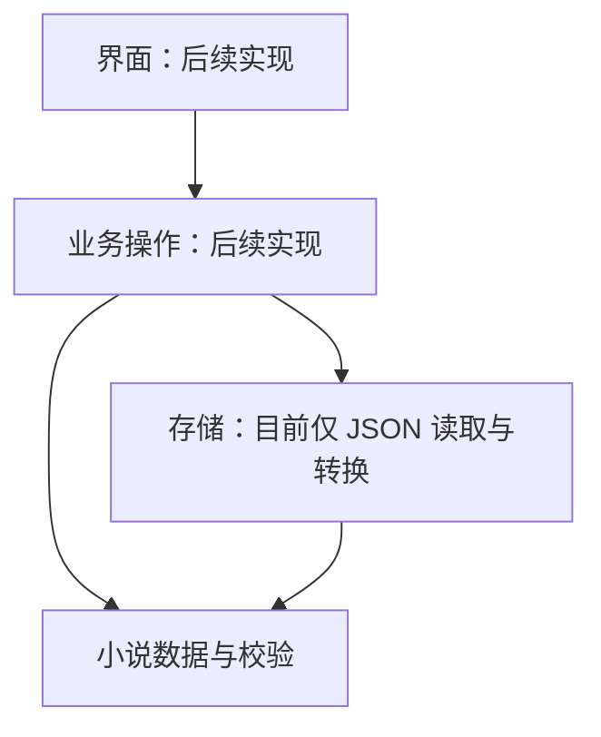

# 模块化架构

第一阶段采用 Python 标准库和 JSON 文件结构，先确定小说内容如何组织。业务、界面和存储各自独立，方便以后增加数据库或模型适配器。

## 模块职责

| 模块 | 路径 | 职责 | 当前状态 |
|---|---|---|---|
| 领域层 | `src/novel_writer/domain/` | 定义小说数据、状态、关联与版本链约束 | 数据定义与校验已实现 |
| 业务层 | `src/novel_writer/application/` | 将创建项目、保存内容、确认章节等操作组织起来 | 只建立目录与包标识 |
| 存储层 | `src/novel_writer/storage/` | 读取和保存小说数据 | 只实现 JSON 读取及转换 |
| 界面层 | `src/novel_writer/ui/` | 展示资料，接收作者操作 | 只建立目录与包标识 |

未来的依赖方向：界面调用业务层；业务层使用领域数据，并通过明确的存储接口读写文件。存储模块使用领域模型解析数据。领域层不导入另外三层。



当前验证脚本直接调用存储层读取示例；这只是开发验证工具，不是成品软件的用户操作入口。

## 当前目录

```text
AI-Novel-Writer/
├── README.md                       原有长期目标
├── AGENTS.md                       开发规范
├── .gitignore                      忽略缓存、实际小说和私人设置
├── pyproject.toml                  项目元信息
├── docs/                           中文说明
├── src/novel_writer/
│   ├── domain/models.py            数据类与完整文档校验
│   ├── application/__init__.py     业务层预留
│   ├── storage/json_codec.py       JSON 读取和转换
│   └── ui/__init__.py              界面层预留
├── examples/sample-novel/          虚构示例与说明
├── scripts/validate_example.py     只读示例校验入口
└── tests/test_models.py            数据约束测试
```

## 存储选择与边界

现阶段设计为每本小说一个独立文档，包含项目、大纲、人物、章节和版本。JSON 可直接阅读，不需要安装数据库，适合验证早期结构。

单文件不是最终的大规模存储方案。长篇正文和多次完整快照会使文件持续变大；后续可将历史快照拆分为独立文件，再在确有搜索和规模需求时增加 SQLite 存储适配器。不能让界面依赖具体文件布局。

现有校验检查数据类型和关联是否成立，不判断故事质量、人物逻辑或剧情时间线是否合理。例如 `story_time` 目前是作者填写的说明文本，不是自动推理的时间线。

`json_codec.py` 不提供写入操作。因此原子保存、防止覆盖、备份、恢复和多个窗口同时编辑的处理都属于下一阶段，不得以“数据模型存在”宣称这些功能已经可用。

## 后续扩展

先完成离线项目管理和可靠保存，再确定界面形式。AI 适配器、模型配置和审核调度放在更后面的阶段，届时独立于领域层实现。第一阶段没有相关依赖、请求代码或密钥配置。
