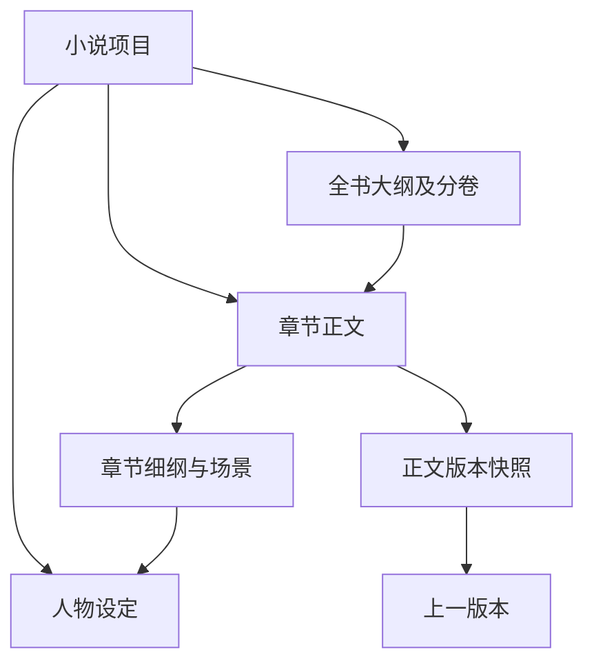

# 小说数据结构，版本 1

本文件与 `src/novel_writer/domain/models.py` 对应。完整示例是 `examples/sample-novel/novel.json`，不包含私人小说。

## 文档根节点

| 字段 | 类型 | 说明 |
|---|---|---|
| `schema_version` | 整数，当前为 `1` | 数据格式版本，读取 JSON 时必须提供 |
| `project` | 小说项目对象 | 必须提供，每份文档只包含一个小说项目 |
| `book_outline` | 全书大纲对象或 `null` | 新项目可以暂时没有大纲 |
| `chapter_outlines` | 章节细纲列表 | 新项目可为空 |
| `characters` | 人物列表 | 新项目可为空 |
| `chapters` | 章节正文列表 | 新项目可为空 |
| `versions` | 版本记录列表 | 新项目可为空 |

读取器允许当前实体省略有默认值的字段，并拒绝未知字段、重复 JSON 字段名和未知格式版本。未来修改格式必须设计迁移，不能静默丢弃数据。

## 通用字段

小说项目、大纲、细纲、人物和章节都有 `id`、`created_at`、`updated_at`。除小说项目本身外，还必须有 `project_id` 指向所属小说。

- `id`：稳定且非空的字符串。程序默认生成 UUID；示例使用易读编号。
- `created_at`、`updated_at`：UTC ISO 8601 时间，例如 `2026-10-13T02:00:00+00:00`。更新时间不能早于创建时间。
- `project_id`：必须与根节点小说项目的 ID 一致。

同一文档的所有当前实体与版本记录 ID 均不能重复。人物改名、书名修改或章节重新排序时，保留原 ID。

## 小说项目：`NovelProject`

| 字段 | 类型 | 说明 |
|---|---|---|
| `title` | 字符串 | 必填，书名不能为空 |
| `author` | 字符串 | 作者名，可留空 |
| `genre` | 字符串 | 小说类型 |
| `summary` | 字符串 | 项目简介 |
| `language` | 字符串 | 默认 `zh-CN` |
| `status` | 状态字符串 | `planning` 规划中、`writing` 创作中、`completed` 已完成、`archived` 已归档 |

## 全书大纲：`BookOutline`

| 字段 | 类型 | 说明 |
|---|---|---|
| `theme` | 字符串 | 核心主题 |
| `premise` | 字符串 | 故事起点与基本设想 |
| `main_plot` | 字符串 | 故事主线 |
| `ending` | 字符串 | 预期结局 |
| `key_events` | 字符串列表 | 全书关键事件 |
| `volumes` | 分卷列表 | 每卷包含 `number`、`title`、`summary`、`chapter_ids` |
| `status` | 状态字符串 | `draft` 草稿、`ready` 可用于后续创作 |

分卷编号为不重复的正整数；`chapter_ids` 指向章节的稳定 ID。同一章不能重复分配到分卷，尚未分卷的章节允许存在。

## 章节细纲：`ChapterOutline`

| 字段 | 类型 | 说明 |
|---|---|---|
| `chapter_id` | 字符串 | 必填，指向所属章节 |
| `core_idea` | 字符串 | 作者提供的本章核心想法 |
| `objective` | 字符串 | 本章要推进的目标 |
| `character_ids` | 字符串列表 | 出场人物的 ID |
| `scenes` | 场景列表 | 每个场景包含 `order`、`summary`、`character_ids`、`location`、`story_time` |
| `story_time` | 字符串 | 作者对本章剧情时间的说明 |
| `status` | 状态字符串 | `draft` 草稿、`ready` 可用于写正文 |

每章最多有一份当前细纲。细纲历史可进入版本记录。场景顺序为不重复的正整数，细纲及场景中的人物必须存在。

## 人物设定：`Character`

| 字段 | 类型 | 说明 |
|---|---|---|
| `name` | 字符串 | 必填，姓名不能为空 |
| `role` | 字符串 | 身份和故事作用 |
| `personality` | 字符串 | 性格描述 |
| `background` | 字符串 | 人物背景 |
| `goals` | 字符串列表 | 人物目标 |
| `notes` | 字符串 | 其他设定 |
| `relationships` | 关系列表 | 每项包含 `target_character_id`、`relation`、`description` |

关系指向人物 ID，不能使用姓名作为关联键。当前仅检查对象存在，不自动生成双方关系，也不检查设定矛盾。

## 章节正文：`Chapter`

| 字段 | 类型 | 说明 |
|---|---|---|
| `number` | 正整数 | 必填，当前小说中的章节顺序，不能重复 |
| `title` | 字符串 | 必填，章节标题不能为空 |
| `content` | 字符串 | 完整正文，允许为空以便先规划章节 |
| `status` | 状态字符串 | `draft` 草稿、`confirmed` 作者已确认 |
| `current_version_id` | 字符串或 `null` | 指向该章节最近关联的保存版本 |

已确认章节必须关联一个存在的正文版本。草稿可暂时没有版本；当前数据模型不检查内存中编辑的正文是否等于最近保存的快照，后续界面需要表示“有未保存的修改”。

改变 `number` 或 `title` 不改变章节 ID，细纲、分卷和版本关联继续有效。历史快照保留当时的标题和顺序。

## 版本记录：`VersionRecord`

| 字段 | 类型 | 说明 |
|---|---|---|
| `id` | 字符串 | 版本记录自身的稳定编号 |
| `project_id` | 字符串 | 所属小说 |
| `entity_type` | 状态字符串 | `project`、`book_outline`、`chapter_outline`、`character` 或 `chapter` |
| `entity_id` | 字符串 | 被保存内容的 ID |
| `version_number` | 正整数 | 同一内容从第 1 版开始递增 |
| `created_at` | UTC 时间字符串 | 此版本的保存时间 |
| `previous_version_id` | 字符串或 `null` | 第 1 版为空，以后指向同一内容的上一版 |
| `change_note` | 字符串 | 本次修改说明 |
| `source` | 状态字符串 | 当前仅支持 `manual`，表示手动内容 |
| `snapshot` | JSON 对象 | 保存时的完整内容字段，包括通用字段 |

章节快照不包含 `current_version_id`，避免把当前版本指针混入历史内容。其他实体快照包含该实体全部字段，嵌套的分卷、人物关系和场景也保存完整字段。

记录自身没有 `updated_at`：历史版本按追加方式管理。校验会检查快照字段完整性、字段类型、目标归属、版本顺序和时间。历史快照中的关联按历史原样保留，不要求它们始终等于当前设定。

目前只支持同一内容的一条线性版本链，不支持版本分支。恢复历史时应创建新版本，保留之前的记录；恢复操作和防止历史文件被改写的存储机制尚未实现。

## 数据关联示意

世界观、文风、自动审核意见和模型调用记录属于未来扩展，本阶段没有添加这些实体。
